# 1

- 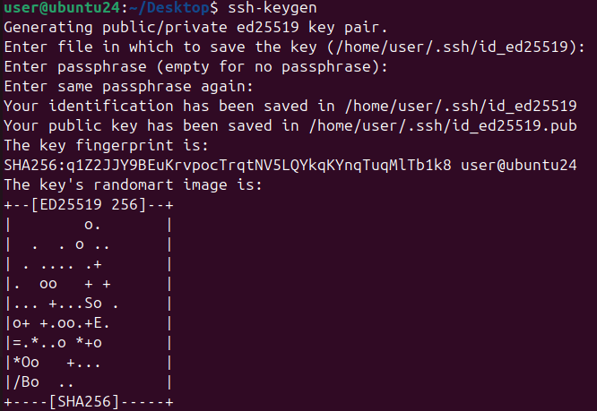\
  *Создаем ssh ключ для гитхаба*

- 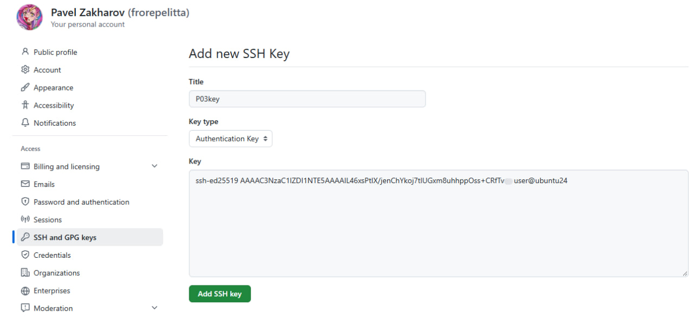\
  *Добавляем ключ в гитхаб*

- 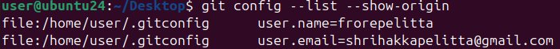\
  *Локальные имя и почта*

- 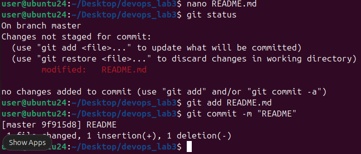\
  *Создаем README и коммитим его*

- 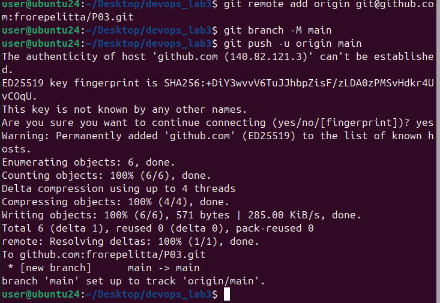\
  *Соединяем локальный гит с гитхабом и пушим*

- 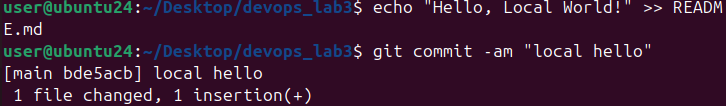\
  *Делаем локальный коммит*

- 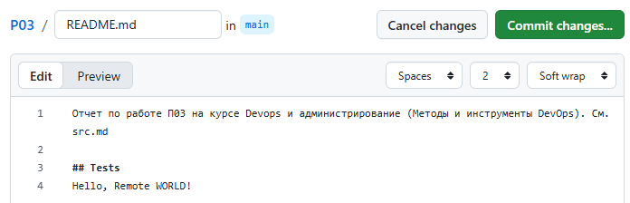\
  *Делаем изменение на сервере*

- 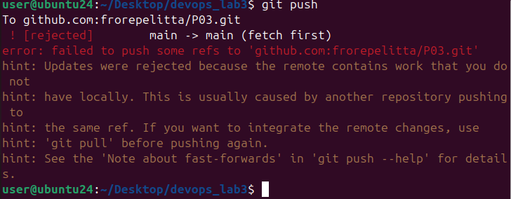\
  *Произошла ошибка*

- 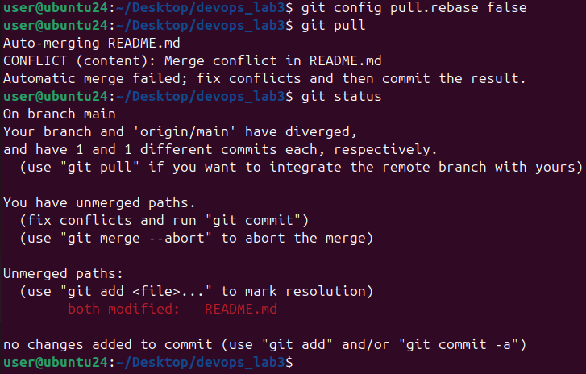\
 *Ошибка git pull*

- 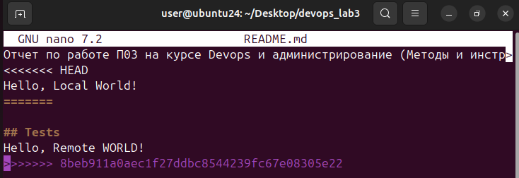\
*README*

- 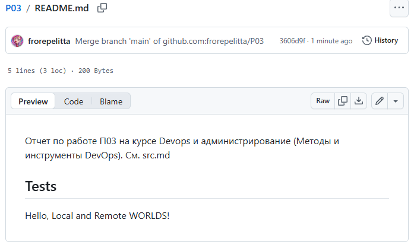\
  *Новая версия README*

- 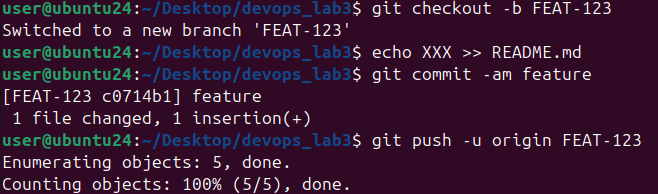
  *Новая ветка*

- 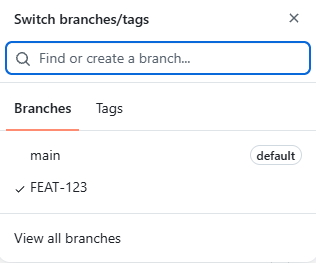
